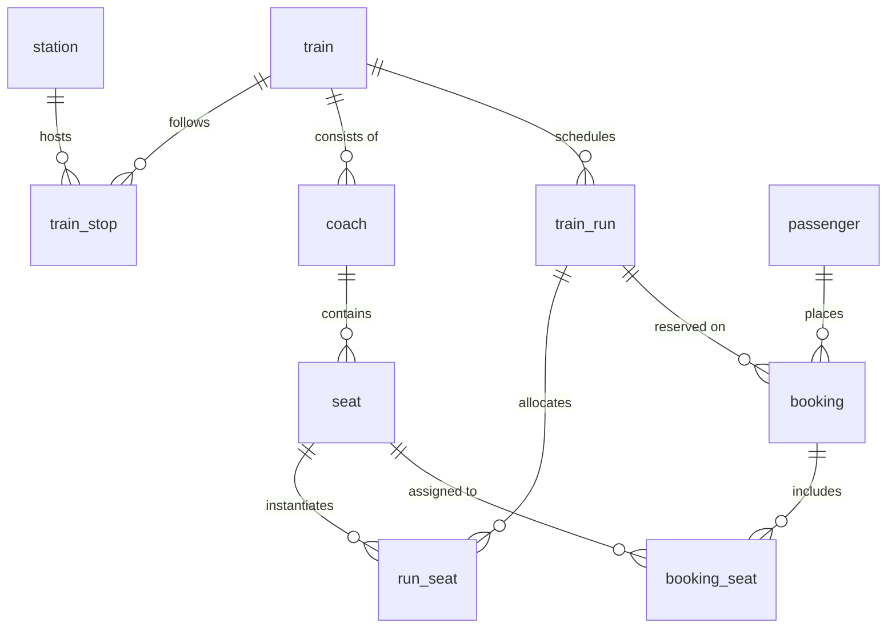

# Smart Railway Management System — Comprehensive DBMS Project Report

---

## 1. Executive Summary & Project Architecture

The **Smart Railway Management System** is a full-stack relational database application designed to manage Indian railway networks, train routes, coach seat inventories, passenger profiles, and transactional ticket bookings.

The application architecture strictly separates concerns across three tiers:
1. **Database Layer (MySQL 8.0 / InnoDB)**: Enforces ACID guarantees, relational integrity, primary/foreign key relationships, domain check constraints, and row-level concurrency locking.
2. **Backend Engine (Python Flask API)**: Executes transactional business logic, dynamic distance/fare calculations, and parameterized SQL queries to prevent SQL injection.
3. **Frontend Interface (Vanilla HTML5 / CSS3 / ES6 JavaScript)**: Provides a real-time reactive interface for two-way route searches, class-based seat selection (`1A`, `2A`, `3A`, `SL`, `CC`, `EC`), ticket generation, and reservation cancellation.

---

## 2. Relational Database Schema & Table Specifications

The system models the railway operations domain into **10 normalized relational tables**:



### Table 1: `station`
Stores master station details across the country.
- **`station_id`** (`INT`, Primary Key, `AUTO_INCREMENT`)
- **`station_code`** (`VARCHAR(10)`, Unique, Not Null) — e.g., `'SBC'`, `'NDLS'`, `'MMCT'`
- **`station_name`** (`VARCHAR(100)`, Not Null) — e.g., `'KSR Bengaluru City'`
- **`city`** (`VARCHAR(100)`, Not Null)
- **`state`** (`VARCHAR(100)`, Not Null)

### Table 2: `train`
Stores distinct train entities.
- **`train_id`** (`INT`, Primary Key, `AUTO_INCREMENT`)
- **`train_number`** (`VARCHAR(10)`, Unique, Not Null) — e.g., `'12627'`, `'12007'`
- **`train_name`** (`VARCHAR(100)`, Not Null) — e.g., `'Karnataka Express'`
- **`train_type`** (`VARCHAR(30)`, Not Null) — e.g., `'Superfast'`, `'Shatabdi'`, `'Rajdhani'`

### Table 3: `train_stop`
Represents the ordered timetable and stops for each train route.
- **`train_id`** (`INT`, Composite Primary Key, Foreign Key -> `train.train_id`)
- **`station_id`** (`INT`, Composite Primary Key, Foreign Key -> `station.station_id`)
- **`stop_number`** (`INT`, Not Null, Unique per train) — Sequence order (1, 2, 3...)
- **`arrival_time`** (`TIME`, Nullable for origin)
- **`departure_time`** (`TIME`, Nullable for destination)
- **`distance_from_source`** (`DECIMAL(8,2)`, Not Null) — Cumulative distance in kilometers

### Table 4: `coach`
Represents physical coaches permanently attached to a train composition.
- **`coach_id`** (`INT`, Primary Key, `AUTO_INCREMENT`)
- **`train_id`** (`INT`, Not Null, Foreign Key -> `train.train_id`)
- **`coach_number`** (`VARCHAR(10)`, Not Null) — e.g., `'S1'`, `'B1'`, `'A1'`, `'H1'`
- **`coach_type`** (`VARCHAR(30)`, Not Null) — e.g., `'Sleeper'`, `'AC 3 Tier'`, `'AC First Class'`
- **Unique Constraint**: `UNIQUE KEY (train_id, coach_number)`

### Table 5: `seat`
Represents physical seat positions within a specific coach.
- **`seat_id`** (`INT`, Primary Key, `AUTO_INCREMENT`)
- **`coach_id`** (`INT`, Not Null, Foreign Key -> `coach.coach_id`)
- **`seat_number`** (`INT`, Not Null, Check Constraint: `1 <= seat_number <= 72`)
- **`berth_type`** (`VARCHAR(20)`, Not Null) — `'Lower'`, `'Middle'`, `'Upper'`, `'Side Lower'`, `'Side Upper'`
- **Unique Constraint**: `UNIQUE KEY (coach_id, seat_number)`

### Table 6: `train_run`
Instantiates a train schedule for a specific operational calendar date.
- **`run_id`** (`INT`, Primary Key, `AUTO_INCREMENT`)
- **`train_id`** (`INT`, Not Null, Foreign Key -> `train.train_id`)
- **`journey_date`** (`DATE`, Not Null)
- **`running_status`** (`VARCHAR(20)`, Check Constraint: `IN ('Scheduled', 'Cancelled', 'Completed')`)
- **Unique Constraint**: `UNIQUE KEY (train_id, journey_date)`

### Table 7: `run_seat`
Maintains real-time reservation availability per seat per dated run.
- **`run_seat_id`** (`INT`, Primary Key, `AUTO_INCREMENT`)
- **`run_id`** (`INT`, Not Null, Foreign Key -> `train_run.run_id`)
- **`seat_id`** (`INT`, Not Null, Foreign Key -> `seat.seat_id`)
- **`seat_status`** (`VARCHAR(20)`, Check Constraint: `IN ('Available', 'Booked', 'Blocked')`)
- **Unique Constraint**: `UNIQUE KEY (run_id, seat_id)`

### Table 8: `passenger`
Stores passenger master directory.
- **`passenger_id`** (`INT`, Primary Key, `AUTO_INCREMENT`)
- **`passenger_name`** (`VARCHAR(100)`, Not Null)
- **`email`** (`VARCHAR(100)`, Unique, Nullable)
- **`phone_number`** (`VARCHAR(20)`, Unique, Nullable)
- **`age`** (`INT`, Check Constraint: `5 <= age <= 120`)
- **`date_of_birth`** (`DATE`, Nullable)

### Table 9: `booking`
Stores ticket transaction headers.
- **`booking_id`** (`INT`, Primary Key, `AUTO_INCREMENT`)
- **`passenger_id`** (`INT`, Not Null, Foreign Key -> `passenger.passenger_id`)
- **`run_id`** (`INT`, Not Null, Foreign Key -> `train_run.run_id`)
- **`booking_date`** (`DATETIME`, Default `CURRENT_TIMESTAMP`)
- **`booking_status`** (`VARCHAR(20)`, Check Constraint: `IN ('Confirmed', 'Cancelled', 'Pending')`)
- **`total_fare`** (`DECIMAL(10,2)`, Check Constraint: `total_fare >= 0`)

### Table 10: `booking_seat`
Associates individual booked seats with a booking transaction and individual seat fares.
- **`booking_seat_id`** (`INT`, Primary Key, `AUTO_INCREMENT`)
- **`booking_id`** (`INT`, Not Null, Foreign Key -> `booking.booking_id`)
- **`seat_id`** (`INT`, Not Null, Foreign Key -> `seat.seat_id`)
- **`seat_fare`** (`DECIMAL(10,2)`, Check Constraint: `seat_fare >= 0`)
- **Unique Constraint**: `UNIQUE KEY (booking_id, seat_id)`

---

## 3. Database Normalization Analysis (1NF to 3NF/BCNF)

A central objective of DBMS design is the elimination of data redundancy, insertion anomalies, update anomalies, and deletion anomalies through formal normalization.

```
+------------------------------------------------------------------------------------+
| 1NF: Atomic attributes; unique rows; no multi-valued columns                       |
+------------------------------------------------------------------------------------+
                                       │
                                       ▼
+------------------------------------------------------------------------------------+
| 2NF: 1NF satisfied + No partial dependencies (all non-key attributes fully         |
|      functionally dependent on composite PK, e.g. in train_stop and booking_seat)  |
+------------------------------------------------------------------------------------+
                                       │
                                       ▼
+------------------------------------------------------------------------------------+
| 3NF / BCNF: 2NF satisfied + No transitive dependencies (non-prime attributes       |
|             depend ONLY on candidate keys, e.g. Coach -> Train, Seat -> Coach)      |
+------------------------------------------------------------------------------------+
```

### First Normal Form (1NF)
- **Atomic Values**: Every attribute contains only atomic, indivisible values. For example, a single booking does not store comma-separated seat numbers like `"S1-1, S1-2"` in a single column; each seat allocation is stored as an individual row in `booking_seat`.
- **Primary Keys**: Every relation has an explicit primary key (`station_id`, `train_id`, `(train_id, station_id)`, `booking_id`, etc.).
- **No Repeating Groups**: Separate rows are used for multiple stops, coaches, and seats rather than repeating columns (`stop1`, `stop2`, `stop3`).

### Second Normal Form (2NF)
A table is in 2NF if it is in 1NF and **no non-prime attribute is partially dependent on any candidate key**.
- **`train_stop` Table**: The candidate key is composite: `(train_id, station_id)`.
  - Non-prime attributes are `stop_number`, `arrival_time`, `departure_time`, and `distance_from_source`.
  - None of these attributes depend solely on `train_id` or solely on `station_id`. They depend on the combination of a train stopping at that specific station.
  - Station metadata (`station_name`, `city`, `state`) was deliberately removed from `train_stop` into `station` to avoid partial dependency.
- **`booking_seat` Table**:
  - The combination `(booking_id, seat_id)` uniquely identifies the seat booked for that transaction. The `seat_fare` depends on the specific booking and seat combination.

### Third Normal Form (3NF) & Boyce-Codd Normal Form (BCNF)
A table is in 3NF if it is in 2NF and **no non-prime attribute is transitively dependent on a candidate key** ($X \rightarrow Y$ and $Y \rightarrow Z$ where $Z$ is non-prime).
- **Separation of Train and Coach**:
  - If coach details were kept in `train`, changes to coach compositions would lead to anomalies. We separated them into `coach` (`coach_id -> train_id, coach_number, coach_type`).
- **Separation of Coach and Seat**:
  - A seat's `berth_type` depends on `seat_id` via `coach_id`. Storing `berth_type` in `run_seat` or `booking_seat` would create a transitive dependency. Thus, `seat` is an independent relation.
- **Separation of Station and Route**:
  - If `train_stop` contained `station_city` or `station_state`, then `(train_id, station_id) -> station_id -> station_city` would be a transitive dependency. By having a normalized `station` table, transitivities are eliminated.
- **Separation of Passenger and Booking**:
  - `booking` references `passenger_id`. Storing `passenger_name` or `phone_number` in `booking` would introduce transitive dependency on `passenger_id`.

---

## 4. Key DBMS Concepts Implemented

### 4.1 ACID Properties & Transaction Management
Ticket booking is an archetype of an ACID transaction. In [backend/app.py](file:///d:/DBMS/Smart-Railway-Management/backend/app.py), the `create_booking` and `cancel_booking` routines enforce ACID principles:

```python
connection.start_transaction()
try:
    # 1. Lock candidate seats in InnoDB with FOR UPDATE
    cursor.execute("SELECT run_seat_id, seat_status FROM run_seat WHERE ... FOR UPDATE")
    
    # 2. Validate availability and business constraints
    ...
    
    # 3. Insert into passenger (or resolve existing passenger)
    # 4. Insert into booking
    # 5. Insert into booking_seat
    # 6. Update run_seat status to 'Booked'
    
    connection.commit()  # Atomicity & Durability guaranteed
except Exception:
    connection.rollback() # Full rollback on any error
```

- **Atomicity**: Either all insertions (`passenger`, `booking`, `booking_seat`) and updates (`run_seat`) succeed together, or `connection.rollback()` leaves the database in its original state.
- **Consistency**: All check constraints (`total_fare >= 0`, `age >= 5`, `seat_status IN (...)`) and foreign key constraints are evaluated by InnoDB before committing.
- **Isolation**: Handled using `FOR UPDATE` pessimistic row locking in InnoDB, isolating concurrent transactions from race conditions.
- **Durability**: Once `connection.commit()` executes, write-ahead logs (redo logs) ensure changes survive server crashes or restarts.

### 4.2 Concurrency Control & Row-Level Locking
To prevent the **Overbooking / Double-Booking Anomaly** (two passengers booking the exact same seat simultaneously):
- The API uses `SELECT ... FOR UPDATE` on the specific `run_seat` rows inside the transaction.
- Other concurrent transactions attempting to read those same seat rows for update are placed in a wait state until the locking transaction commits or rolls back.

### 4.3 Integrity Constraints
- **Domain Constraints**: `DECIMAL(10,2)` for financial values, `TIME` for schedules, `DATE` for journey dates.
- **Entity Integrity**: Explicit `PRIMARY KEY` on every table; non-null primary keys.
- **Referential Integrity**: Cascading checks via `FOREIGN KEY (...) REFERENCES (...)`.
- **User-Defined CHECK Constraints**:
  - `passenger_chk_1`: `CHECK (age >= 5 AND age <= 120)`
  - `seat_chk_1`: `CHECK (seat_number BETWEEN 1 AND 72)`
  - `booking_chk_1`: `CHECK (booking_status IN ('Confirmed', 'Cancelled', 'Pending'))`
  - `booking_chk_2`: `CHECK (total_fare >= 0)`

---

## 5. Multi-Table JOIN Architectures & SQL Implementation

### 5.1 Route Search with Self-Join on `train_stop`
To find trains traveling between origin station $A$ and destination station $B$, the system joins `train_stop` twice on `train_id`, ensuring the sequence order $stop_A < stop_B$:

```sql
SELECT 
    r.run_id,
    t.train_number,
    t.train_name,
    t.train_type,
    r.journey_date,
    s1.station_name AS origin_name,
    s1.station_code AS origin_code,
    ts1.departure_time,
    s2.station_name AS destination_name,
    s2.station_code AS destination_code,
    ts2.arrival_time,
    (ts2.distance_from_source - ts1.distance_from_source) AS distance_km,
    SUM(CASE WHEN rs.seat_status = 'Available' THEN 1 ELSE 0 END) AS available_seats
FROM train_run r
JOIN train t ON t.train_id = r.train_id
JOIN train_stop ts1 ON ts1.train_id = t.train_id
JOIN station s1 ON s1.station_id = ts1.station_id
JOIN train_stop ts2 ON ts2.train_id = t.train_id
JOIN station s2 ON s2.station_id = ts2.station_id
LEFT JOIN run_seat rs ON rs.run_id = r.run_id
WHERE r.journey_date = '2026-11-25'
  AND s1.station_code = 'SBC'
  AND s2.station_code = 'NDLS'
  AND ts1.stop_number < ts2.stop_number
GROUP BY r.run_id, t.train_id, t.train_number, t.train_name, t.train_type,
         r.journey_date, s1.station_name, s1.station_code, ts1.departure_time,
         s2.station_name, s2.station_code, ts2.arrival_time,
         ts1.distance_from_source, ts2.distance_from_source
ORDER BY ts1.departure_time;
```

### 5.2 Six-Table JOIN: Passenger Ticket Retrieval
Retrieves complete ticket metadata linking the passenger, reservation, journey date, train, coach, and individual seat allocations:

```sql
SELECT 
    b.booking_id,
    b.booking_date,
    b.booking_status,
    b.total_fare,
    p.passenger_name,
    p.email,
    p.phone_number,
    r.journey_date,
    t.train_number,
    t.train_name,
    t.train_type,
    GROUP_CONCAT(
        CONCAT(c.coach_number, '-', s.seat_number, ' (', c.coach_type, ', ', s.berth_type, ')')
        ORDER BY c.coach_number, s.seat_number SEPARATOR ', '
    ) AS allocated_seats
FROM booking b
JOIN passenger p ON p.passenger_id = b.passenger_id
JOIN train_run r ON r.run_id = b.run_id
JOIN train t ON t.train_id = r.train_id
JOIN booking_seat bs ON bs.booking_id = b.booking_id
JOIN seat s ON s.seat_id = bs.seat_id
JOIN coach c ON c.coach_id = s.coach_id
WHERE b.booking_id = 11
GROUP BY b.booking_id, b.booking_date, b.booking_status, b.total_fare,
         p.passenger_name, p.email, p.phone_number, r.journey_date,
         t.train_number, t.train_name, t.train_type;
```

### 5.3 Analytical Occupancy Percentage Query
Aggregates seat occupancy rates across all runs to demonstrate managerial analytics:

```sql
SELECT 
    r.run_id,
    t.train_number,
    t.train_name,
    r.journey_date,
    COUNT(rs.run_seat_id) AS total_capacity,
    SUM(CASE WHEN rs.seat_status = 'Booked' THEN 1 ELSE 0 END) AS occupied_seats,
    ROUND(
        (SUM(CASE WHEN rs.seat_status = 'Booked' THEN 1 ELSE 0 END) * 100.0) / 
        NULLIF(COUNT(rs.run_seat_id), 0), 2
    ) AS occupancy_percentage
FROM train_run r
JOIN train t ON t.train_id = r.train_id
JOIN run_seat rs ON rs.run_id = r.run_id
GROUP BY r.run_id, t.train_number, t.train_name, r.journey_date
ORDER BY r.journey_date DESC;
```

---

## 6. Summary of Engineering Tasks Completed

1. **Two-Way Connected Routes Seeded**:
   - Implemented return journeys (`12628`, `12008`, `12001`, `12952`, `20653`, `16536`, `17326`, `12123`, `12124`) across 53 stations.
2. **Distinct Travel Classes Configured**:
   - Added `1A` (AC First Class), `2A` (AC 2 Tier), `3A` (AC 3 Tier), `SL` (Sleeper), `CC` (AC Chair Car), and `EC` (Executive Chair Car) coaches, seats, and inventory.
3. **Frontend UI Enhancements**:
   - Interactive class filter tabs (`All`, `1A`, `2A`, `3A`, `SL`, `CC`, `EC`).
   - Grouped coach seat map with berth types and real-time status legend.
   - Popular route quick-selection pills.
   - Live **All Bookings** reservation log with per-ticket status badges and one-click cancellation.
4. **Defensive Error Handling**:
   - Fixed `TypeError: Cannot read properties of null (reading 'reset')` by retaining a permanent DOM reference before `await`.
   - Prevented unique-key collisions when repeat passengers book tickets.
   - Aligned Python validations with MySQL check constraints (`5 <= age <= 120`).
5. **Project Documentation & Verification**:
   - Created safe, drop-free DDL in [database/schema.sql](file:///d:/DBMS/Smart-Railway-Management/database/schema.sql).
   - Created full DBMS analytical query reference suite in [database/queries.sql](file:///d:/DBMS/Smart-Railway-Management/database/queries.sql).
   - Created automated end-to-end verification suite in [test_system.py](file:///d:/DBMS/Smart-Railway-Management/test_system.py).
